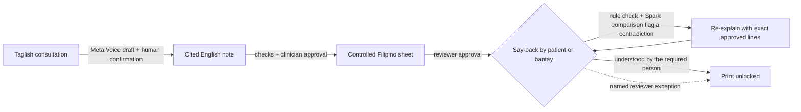

# KlinikaFlow

**KlinikaFlow won't print a patient's take-home instructions until the patient, or the *bantay* (family companion) who will give the medicine, has said them back correctly.**

In a Philippine Rural Health Unit, the last minutes of a consult decide what a patient does at home. The doctor explains in Taglish. The patient leaves with an English slip, or with nothing, and nobody checks what they understood. PSA reports that 24.2% of Filipinos had functional health literacy in 2024. KlinikaFlow is a synthetic-only prototype of a different ending to that consult:

1. **Consultation.** Record the Taglish consultation. Meta Voice drafts the transcript, and a person confirms the speakers and corrects the text.
2. **Review note.** Spark drafts a structured English note. Every instruction cites the turn it came from, deterministic checks flag missing or changed instructions, and a clinician approves it.
3. **Review instructions.** A controlled Filipino template renders the take-home sheet, with no free-form model wording, and a reviewer approves it line by line.
4. **Check understanding.** The patient or companion explains each instruction in their own words. A free **Taglish rule check** and an optional Spark comparison flag any answer that contradicts the approved sheet. A **comprehension map** shows, line by line, who said what. **Printing stays locked** until every answer is understood by the right person, or a named reviewer records an exception.

Transcription and drafting are inputs. The product is the closed loop at step 4.



## What makes it different

| Typical tool | KlinikaFlow |
| --- | --- |
| AI scribes stop at the clinician's note | Starts at the note and ends when the instructions have been said back |
| Translation apps translate whatever they're given | Renders only approved facts through controlled Filipino templates; every line traces to a cited source turn |
| Teach-back is a checkbox | Every attempt, recording and contradiction is kept; "re-explained" never counts as understood |
| The patient is assumed to be the one who acts | A *bantay* can be required to say back the instructions they will carry out (for example, giving the medicine) |

### Taglish rule check (`backend/src/domain/taglish.ts`)

A deterministic reader for Filipino, English and Spanish-derived Taglish numbers (`limang daan`, `dalawampu't lima`, `tres`), frequencies (`kada anim na oras` → 4 a day), durations, meal timing, return urgency (`agad` versus `pagkatapos ng tatlong araw`) and negation (`huwag`, `bawal`, `walang`). It compares each answer with the approved line's structured fact and quotes the exact words on both sides. It makes no model call and costs nothing, so it also runs in Saved Demo.

Marking a flagged answer "understood" requires a written reason, which is saved on the attempt. The rule check never decides understanding.

## Try it (Saved Demo, no keys, no paid calls)

```bash
npm install
npm run dev            # http://localhost:3000/?demo=1
```

From **Menu → Test cases, evidence & usage**, open **"Dengue warning signs, with a bantay"** (case-04). The companion's saved answer plans to give ibuprofen. The rule check flags that it breaks *"Huwag uminom ng ibuprofen o aspirin"*, and print stays locked until a repeat answer from the companion is understood.

Accounts with live Meta models need an administrator-approved account and server-side configuration. See `.env.example`.

## Checks

```bash
npm run check          # typecheck, 244 tests, production build
npm run eval           # offline: 4 reference cases + rule-check corpus; no paid calls
```

Latest offline results (synthetic fixtures only):

- 4/4 reference cases pass, and 4/4 planted immediate-versus-delayed regressions are caught.
- On a 43-answer synthetic, author-written development set, the rule check flags 23/23 contradictions and raises 0/20 false alarms on correct answers. This set was written alongside the parser, so it is not held-out or native-speaker evidence.

## Invariants and where they are enforced

| Invariant | Enforced in | Tested by |
| --- | --- | --- |
| Patient or unknown speech cannot authorize an instruction | `domain/workflow.ts` `checkEncounter` | `workflow.test.ts` "does not allow patient or unknown speech…" |
| Every sheet line traces to a cited claim; wording must match the controlled template | `checkEncounter` | "rejects an untraced sheet line", "catches incorrect visible wording…" |
| Immediate return can't become a delay; `huwag` can't flip | `checkEncounter`, `taglish.ts` | "catches immediate return changed to after three days", "flags flipped huwag", `taglish.test.ts` |
| Any edit clears dependent approvals and archives answers | `invalidate` | "clears everything after an uncited transcript edit", "keeps note approval after a sheet edit" |
| Print needs every current answer understood by the required person, or a current named exception | `unresolvedTeachBack`, `exportReasons` | `print-exception.test.ts`, `attempts.test.ts` "requires the bantay to say back the medicine…" |
| A rule-check contradiction can't be marked understood without a written reason | `actions.ts` `record-teach-back` | `attempts.test.ts` "requires a reason to mark a flagged answer understood…" |
| Every attempt and its audio is kept | `startAttempt`, teach-back audio route | `attempts.test.ts` "keeps first and repeated saved answers…" |
| Model findings must quote real sheet and answer text | `server/review.ts` | `ai-features.test.ts` |
| Paid operations need explicit operator action; agents can't approve, print or decide understanding | `server/agent.ts`, `domain/agent-policy.ts` | `agents.test.ts` |
| Admins see identities and usage, never another account's encounters | `server/accounts.ts` | `accounts.test.ts` "isolates member and admin content and usage" |
| Keys stay server-side | `server/meta.ts`, `server/http.ts` | `http.test.ts` "returns model usage without a budget or server credential" |

## Meta models

- `muse-voice-transcribe-1.0`: consultation and teach-back answer transcription.
- `muse-spark-1.3`: structured note drafting, source discrepancy review, teach-back comparison and optional bounded agent planning (structured JSON, server-validated).

Live inference evidence so far is limited to a completed six-call Spark plan-question comparison. Live Voice, full-case and agent runs are pending actor recordings.

## What this is not

- **Synthetic only.** No real patients, no deployment.
- The Filipino templates, including the case-04 dengue wording, are drafts pending clinician and native-speaker review.
- Scripted repeat answers show how the workflow behaves, not patient comprehension. No clinical, language or comprehension validation is claimed.

## Layout

`web/`: Next.js UI and thin API adapters. `backend/src/domain/`: pure workflow rules, the Taglish parser and the comprehension map. `backend/src/server/`: storage (Node SQLite), accounts and model adapters. `backend/tests/`: Vitest. `backend/scripts/evaluate.ts`: capability harness.
